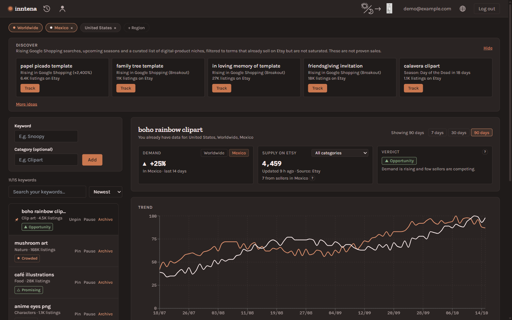
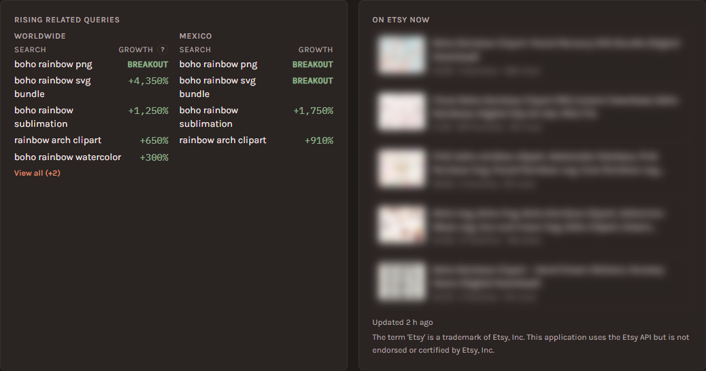
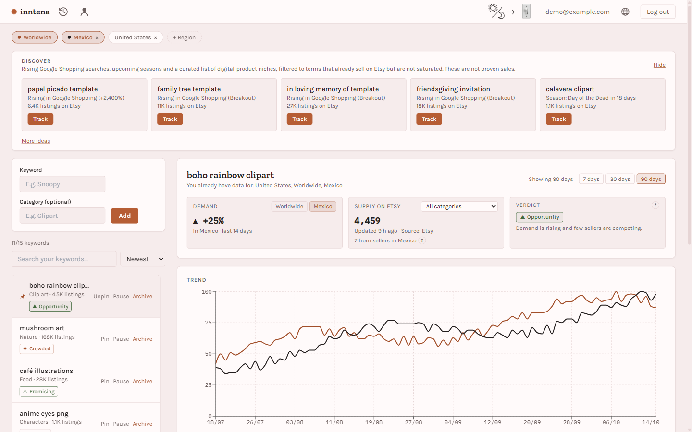
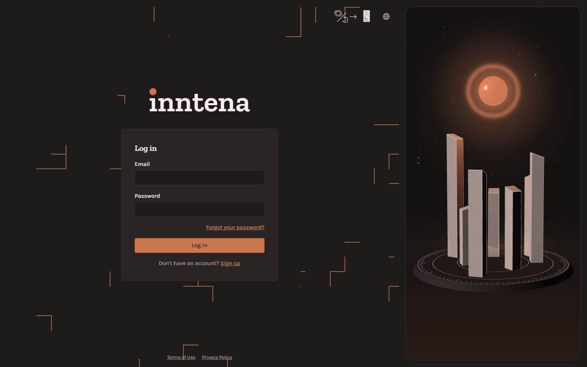
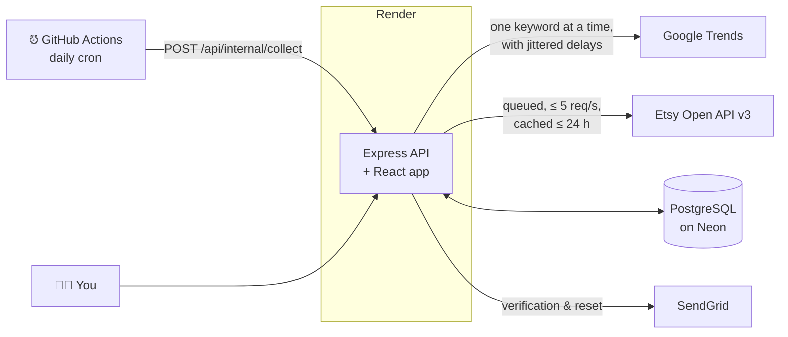

<div align="center">

<picture>
  <source media="(prefers-color-scheme: dark)" srcset=".github/assets/logo-dark.png">
  
</picture>

### Spot the next Etsy trend before everyone else is selling it.

Inntena tracks what people are starting to search for, checks how many sellers already offer it on Etsy,<br>
and tells you which niches are still open — free, open source, and self-hostable.

<br>

[**Try the live demo →**](https://niche-radar.onrender.com)

<br>

[](https://github.com/arambs22/inntena/actions/workflows/ci.yml)

[](./LICENSE)

<br>


<br>


<br>

[Features](#-what-it-does) · [How it works](#-how-it-works) · [Run it locally](#-run-it-locally) · [Tech stack](#-tech-stack) · [Roadmap](#-roadmap) · [Contributing](#-contributing)

</div>

---

## Why Inntena?

If you sell digital products on Etsy (clip art, SVGs, printables, planners), timing is everything. Arrive
early to a niche and you have the shelf almost to yourself; arrive late and you are listing number
100,000. Tools that answer *"what's about to take off?"* exist (eRank, Alura, Everbee), but they are paid
and closed.

Inntena puts the two signals that matter side by side:

| | Signal | Source |
|---|---|---|
| 📈 | **Demand**: is search interest rising? | Google Trends, by region |
| 🏪 | **Supply**: how many sellers already compete? | Etsy's live listing count |

When demand is climbing and few people are selling yet, that's an **Opportunity**.

---

## ✨ What it does



### 🔭 Discover: ideas you are not tracking yet
A strip of fresh niche ideas at the top of the dashboard, built from three sources:
- **Rising Google Shopping searches**: buying-intent queries growing fast right now, such as *"papel picado template"* or *"friendsgiving invitation"*.
- **Upcoming seasons**: Halloween, Day of the Dead, Christmas and more, suggested weeks before they peak.
- **A curated list of 168 digital-product niches**, shuffled daily.

Every idea is filtered to terms that **already sell on Etsy (1,000–100,000 listings) but aren't saturated**.
Not into any of them? Hit **More ideas**. One click on **Track** adds an idea to your list.

### 🧭 The verdict: demand × supply
For each keyword, Inntena compares the last 14 days of search interest with the 14 before, and puts that
next to the number of competing Etsy listings. You get a plain-language verdict:

`▲ Opportunity` · `△ Promising` · `→ Steady` · `◆ Crowded` · `▼ Cooling`

Pick the Etsy category that matches your product (Craft Supplies, Paper & Party, Weddings…) and the supply
count narrows to your real competition. Pick a region and you also see how many of those sellers are local.

### 🌍 Multi-region trend charts
Compare up to three regions at once against Worldwide, over 7, 30 or 90 days. The chart sits next to the
**rising related searches** for each region, with growth shown as `+4,350%` or `BREAKOUT`.



### 🛍️ On Etsy now
The top five Etsy listings for your keyword, each linking straight to Etsy, so you can see what the
competition looks like before you design anything. Listing examples are blurred in the screenshot above
because they belong to their sellers. In the app they are shown live and never older than 6 hours, as
Etsy's API terms require.

### 🗂️ And the everyday things
- **Pin, sort, search and archive** keywords. Archived ones keep their data for 15–90 days and can be restored.
- **Up to 15 active keywords** per account, so daily collection stays fast and polite to Google.
- **Automatic daily collection.** If Google blocks a run, the dashboard tells you when and why.
- **Light and dark themes** and an **English / Español** interface, remembered per browser.
- **Full account management**: email verification, password reset, password change and account deletion.

<details>
<summary><b>☀️ See it in light mode</b></summary>
<br>

</details>

<details>
<summary><b>🔐 See the sign-in page</b></summary>
<br>

</details>

---

## ⚙️ How it works



1. **Collect.** Once a day a GitHub Actions workflow triggers a protected endpoint. The server walks every
   tracked keyword and region one request at a time, with jittered delays, so it never hammers Google.
   - A circuit breaker stops the run on repeated failures.
   - An HTML response from Google means the run was blocked, so it stops at once and reports it.
   - The workflow waits for the real outcome and fails loudly if the run did not finish.
2. **Enrich.** When you open the dashboard, Etsy listing counts are fetched on demand through a rate-limited
   queue, shared and cached across users, and never shown when older than 24 hours.
3. **Decide.** The browser combines demand momentum and supply into the verdict, so changing region or
   category is instant.

Everything Etsy-related is **optional**. Without an Etsy key, Inntena still works fully on Google Trends data.

---

## 🚀 Try it

**👉 [niche-radar.onrender.com](https://niche-radar.onrender.com)**

Create a free account, add a keyword like `boho rainbow clipart`, and check back after the next daily
collection. Or start straight from the **Discover** strip.

> The demo runs on free hosting, so new keywords get their data on the next daily run, and Google
> occasionally rate-limits shared server IPs. If that happens, the dashboard says so and the next run
> retries.

---

## 💻 Run it locally

You need **Node.js 20+** and **Docker Desktop** (for PostgreSQL).

```bash
# 1. Clone and install
git clone https://github.com/arambs22/inntena.git
cd inntena
npm install
npm install --prefix client

# 2. Configure: copy the example env and fill in two secrets
cp .env.example .env
openssl rand -base64 48   # run twice: one for JWT_SECRET, one for CRON_SECRET (≥ 32 chars each)

# 3. Start Postgres and create the schema
docker compose up -d
npm run db:migrate

# 4. Run backend and frontend (two terminals)
npm run dev                 # API on http://localhost:3000
npm run dev --prefix client # app on http://localhost:5173
```

Open **http://localhost:5173**, sign up, and you're in. In development, verification and reset emails are
printed to the server console, so no email account is needed.

<details>
<summary><b>Collect some data right away</b></summary>

```bash
npm run collect -- --geo=US     # one region; omit --geo for Worldwide
```
Collection is deliberately sequential and slow (about 20 seconds per keyword and region), so Google
doesn't block you.
</details>

<details>
<summary><b>Want fake data to explore the UI?</b></summary>

`docker/seed-dev.sql` fills an existing account with 12 realistic keywords, 90 days of trends in two
regions and rising searches. **Local development only.**

```bash
docker exec -i inntena-postgres psql -U inntena -d inntena -v email=you@example.com < docker/seed-dev.sql
```
</details>

<details>
<summary><b>Optional integrations (Etsy, email)</b></summary>

| Variable | What it enables |
|---|---|
| `ETSY_API_KEY` + `ETSY_API_SECRET` | Supply counts, verdicts, Etsy filtering in Discover. Get them at [etsy.com/developers](https://www.etsy.com/developers). |
| `ETSY_LISTING_SAMPLES_ENABLED=true` | The "On Etsy now" listing examples. Turn it on only once Etsy has approved that use for your app. |
| `SENDGRID_API_KEY` + `SENDGRID_FROM_EMAIL` | Real verification and reset emails, sent over HTTPS, so it works on hosts that block SMTP. |
| `SUPPORT_EMAIL`, `OPERATOR_NAME` | Contact details shown in the footer and on the legal pages. |

If you host your own instance with Etsy enabled, read Etsy's API Terms and adapt the Terms and Privacy pages
(`client/src/lib/legalContent.ts`) to your deployment.
</details>

<details>
<summary><b>Tests</b></summary>

```bash
cp .env.test.example .env.test
npm test                    # 230+ backend tests against a real Postgres test database (no mocks)
npm test --prefix client    # 150+ frontend logic tests
```
CI runs typecheck, lint, `npm audit` and both suites on every push.
</details>

<details>
<summary><b>Deploy your own</b></summary>

`render.yaml` is a ready Render Blueprint. Point `DATABASE_URL` at any Postgres (the demo uses
[Neon](https://neon.tech)), set the secrets in the Render dashboard, and every deploy runs the migrations
before the server starts. To get daily collection, set the repo secrets `NICHERADAR_URL` (your app URL) and
`CRON_SECRET` for `.github/workflows/collect-trends.yml`.
</details>

---

## 🧱 Tech stack

| Layer | Tools |
|---|---|
| **Frontend** | React 19, Vite, TypeScript, Tailwind CSS, React Router, Recharts, Three.js |
| **Backend** | Node.js 22, Express, TypeScript, Zod |
| **Data** | PostgreSQL, Drizzle ORM and drizzle-kit migrations |
| **Auth & security** | bcrypt, JWT in an httpOnly cookie, Helmet with a strict CSP, per-IP rate limiting, single-use hashed tokens |
| **Integrations** | Google Trends (unofficial API), Etsy Open API v3, SendGrid |
| **Infra** | Render (app), Neon (database), GitHub Actions (CI and daily cron), Dependabot |
| **Quality** | Vitest and Supertest against a real database, oxlint, `npm audit` in CI |

---

## 🗺️ Roadmap

Inntena is **actively developed**. Next up:

- [ ] Better Discover ideas as more Google Shopping data accumulates
- [ ] Translate backend error messages (the UI is bilingual, some API errors are still Spanish-only)
- [ ] Component and end-to-end tests for the frontend
- [ ] Shared state (rate limits, queues) ready for more than one server instance

Ideas on the table, not started yet:
- **Prompt suggestions** for AI image tools based on a detected trend
- **Browser extension** that shows Inntena's verdict directly on Etsy search pages

Have an idea? [Open an issue](https://github.com/arambs22/inntena/issues). Feedback from real sellers is the most valuable kind.

---

## 🤝 Contributing

Contributions are very welcome: bug reports, ideas, translations, docs or code. Read
**[CONTRIBUTING.md](./CONTRIBUTING.md)** to get set up, then open a pull request against `main`. Small,
focused PRs with a test are the easiest to review.

---

<div align="center">

**Built by [Aram Barsegyan](https://github.com/arambs22)** — a Systems Engineering student and Etsy clip-art seller who wanted this tool to exist.

[MIT License](./LICENSE) · © 2026

<sub>The term "Etsy" is a trademark of Etsy, Inc. This application uses the Etsy API but is not endorsed or certified by Etsy, Inc. Google Trends data is accessed through an unofficial client and is not endorsed by Google.</sub>

</div>
